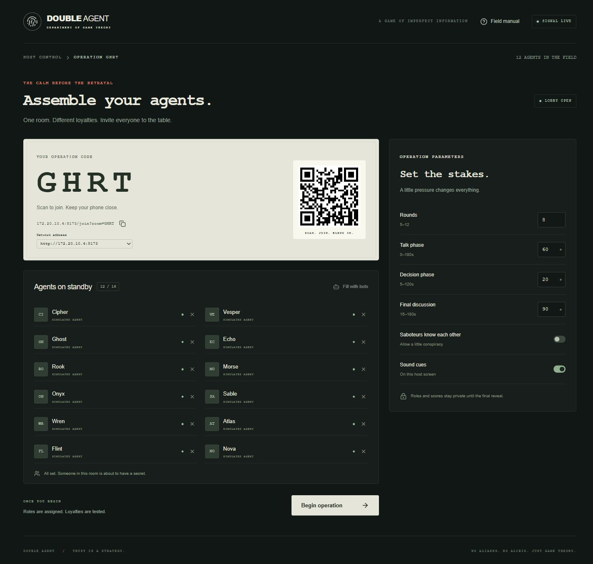

# DOUBLE AGENT

**Trust is a strategy. Betrayal is an art.**

A social-deduction game for a college event: everyone gets a partner, everyone makes a promise, and a few players secretly benefit when those promises fall apart.

**6–16 players · one projector · one phone per player · about 15 minutes**



## Try it on your laptop

Install [Node.js 24 LTS](https://nodejs.org/), then run:

```sh
git clone https://github.com/NotCapt/NeuralNash.git
cd NeuralNash
npm install
npm run dev
```

Open **[localhost:5173](http://localhost:5173)** → **Create an operation** → **Fill with bots** → **Begin operation**.

You can run a whole game alone with bots. Use **Skip timer** to move faster; skipping a decision immediately applies timeout defaults.

## Host a game with friends

1. Put the laptop and phones on the **same Wi-Fi**.
2. Start the app and click **Create an operation**.
3. Project the host screen. Players scan its QR code and enter a name.
4. Check the roster, adjust timers if needed, and click **Begin operation**.
5. After results, download **JSON** or **CSV** to keep the game record.

The QR uses your laptop’s Wi-Fi address. If multiple networks appear, select the Wi-Fi adapter. The host is an observer; use a separate phone if you also want to play.

For the actual event, use the production build so source edits do not restart your game:

```sh
npm run build
npm start
```

Then open **[localhost:3001](http://localhost:3001)**. Keep the laptop awake and the terminal running.

## How to play

### 1. Read your secret assignment

Hold **My role** on your phone. Release to hide it.

| Role         | Objective                                        | Round score                        |
| ------------ | ------------------------------------------------ | ---------------------------------- |
| **Loyal**    | Earn points and identify Saboteurs               | Your own base payoff               |
| **Saboteur** | Make partners do badly without exposing yourself | 5 minus your partner’s base payoff |

One quarter of the room, rounded down, are Saboteurs (at least one). Roles and scores stay private until the end.

### 2. Talk, then choose

Each round brings a new pairing. Talk to your partner, then secretly choose **Cooperate** or **Defect**. You can change your mind until time runs out.

| You       | Partner   | Your base payoff | Their base payoff |
| --------- | --------- | ---------------: | ----------------: |
| Cooperate | Cooperate |                3 |                 3 |
| Cooperate | Defect    |                0 |                 5 |
| Defect    | Cooperate |                5 |                 0 |
| Defect    | Defect    |                1 |                 1 |

The projector reveals everyone’s moves. Your phone shows your points. No choice defaults to Cooperate. With an odd player count, one person gets a fair, rotating bye worth zero points.

### 3. Name your suspect

After the final round, discuss the evidence and secretly name **one other player**.

- A Loyal who names a Saboteur gets **+3**.
- Each Saboteur gets **+2 for every Loyal who did not name them**.
- A missed ballot becomes a random other player, recorded as a timeout.

Roles are revealed, followed by **separate Loyal and Saboteur leaderboards**. Their scoring scales differ, so there is no combined ranking.

## Host controls

| Control        | Effect                                                   |
| -------------- | -------------------------------------------------------- |
| Pause / Resume | Freezes the countdown, moves and ballots                 |
| Skip timer     | Ends the current phase immediately                       |
| End early      | Keeps completed rounds and opens accusations             |
| Restart        | Clears this game and returns the same seats to the lobby |
| Fill with bots | Tops up the lobby to 12 players for testing              |

Defaults: **8 rounds**, **60 seconds** to talk, **20 seconds** to choose, **90 seconds** for accusations. Four players can start; six or more is recommended.

## Troubleshooting

| Problem                        | Try this                                                                               |
| ------------------------------ | -------------------------------------------------------------------------------------- |
| Phone cannot open the local QR | Check Wi-Fi, selected adapter and laptop firewall. Guest networks may isolate devices. |
| Start button is disabled       | Join four players, or fill with bots.                                                  |
| Phone sleeps or refreshes      | Reopen the same join link in the same browser; its saved token restores the seat.      |
| Local tabs fight over a seat   | Use separate browser profiles for separate players.                                    |
| Local rooms disappeared        | The Node server restarted. Export results before stopping it.                          |

## Development

| Command                                         | Purpose                                                  |
| ----------------------------------------------- | -------------------------------------------------------- |
| `npm run dev`                                   | Start React/Vite and Node/Socket.IO together             |
| `npm test`                                      | Check rules, reconnects, privacy and hosted concurrency  |
| `npm run build`                                 | Type-check and build the local production app            |
| `npm run build:sites`                           | Build the Cloudflare Worker version for ChatGPT Sites    |
| `npm run simulate -- --players 12 --games 1000` | Run reproducible bot games and report balance statistics |

**Two deployments, one game engine:** LAN play uses Socket.IO and in-memory rooms. Sites uses HTTPS polling and D1 storage, with version-checked updates to prevent simultaneous requests overwriting each other. Both send each seat only its permitted view. Hosted timers catch up from server deadlines when clients poll, including after all devices have slept.

`client/` holds the screens; `server/` the rules and local server; `worker/` the hosted gateway; `shared/` the wire types; `tests/` the checks.

- [Detailed LAN setup, read-aloud rules and edge cases](docs/LOCAL_SETUP.md)
- [Privacy audit](docs/SECURITY.md)
- [Validation and simulation results](docs/VALIDATION.md)
- [Phone screen preview](docs/screenshots/phone-decision.jpg)
